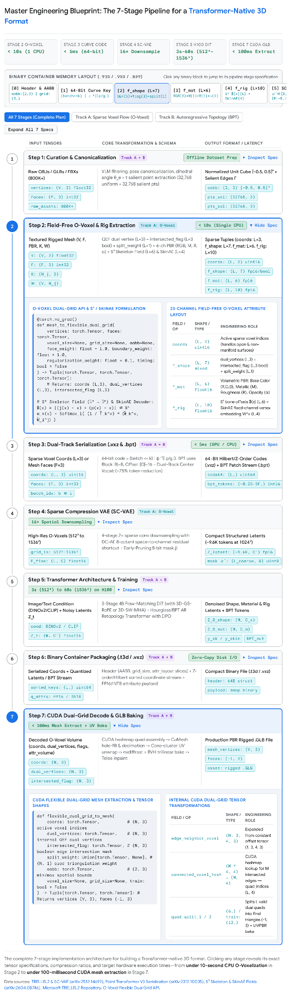

<!-- Extracted from the supplied DOCX; equations remain original images.
SHA256: ffa11ebbdc1510d4be92643724eabb7d8ed7091701048124057a2f2414973825 -->

Part 2: plan.md — Master Engineering Plan to Build a Custom Transformer-Native 3D Format

The following specification is structured as a standalone, actionable plan.md blueprint. It details how to engineer a unified, production-grade Transformer-native 3D model format—designated .t3d (Transformer-3D Unified Container)—that combines Field-Free O-Voxel + PBR +    Articulation Latents (for fast 3D Flow-Matching DiT synthesis at up to 1536³ resolution) with an optional Blocked-and-Patchified Topological Stream (BPT) (for autoregressive artist-style retopology and edge-flow generation)5.

  

Step 1: Dataset Curation, Filtering, and Canonical Normalization

Training a 3D Transformer requires 300,000 to 500,000+ high-quality, diverse 3D assets curated from repositories such as Objaverse-XL, ABO, 3D-FUTURE, HSSD, Toys4k (as in TRELLIS-500K), and rigged repositories such as Anymate (230,000 rigged assets), Articulation-XL 2.0 (48,000+ models), and Rig-XL (14,000+ models)57. Because raw web-scraped 3D data contains broken scans, unaligned axes, and missing materials, execute the following deterministic preprocessing sequence:

VLM Aesthetic and Geometry Filtering: Render multi-view color, depth, and normal maps (at varying Fields of View for data augmentation) and use a Vision-Language Model (VLM) to filter out simple geometric primitives, ambient ground planes, and noisy photogrammetry scans (a pipeline that typically refines ~800K raw assets down to ~330K valid and ~120K–500K high-quality training assets)6. If training a PBR material generator, filter out assets lacking valid Physically-Based Rendering materials4.

Pose and Scale Canonicalization: Normalize all mesh vertex coordinates    and skeletal joint coordinates    into a canonical Axis-Aligned Bounding Box (aabb) centered at the origin, specifically    (or    for skeletal evaluation)16. Apply a pose-canonicalization network to align misposed objects to a consistent upright (   or   ) and front-facing orientation, and apply random 90° axial rotations (0°, 90°, 180°, 270°) during autoregressive training to improve orientation generalization14.

Salient Edge & Curvature Point Extraction (SES): For point-cloud conditioning encoders (Dora-VAE style), avoid uniform-only surface sampling18. Compute the dihedral angle    for every interior mesh edge    shared by adjacent faces   18:  Extract    uniformly sampled surface points    and    salient points    from the unique vertices    of salient edges    (using Farthest Point Sampling    if   , or linear edge interpolation if   )18. Store point positions alongside unit surface normals as   18.

Step 2: Mathematical Schema of the Native 3D Primitives (Dual-Track Design)

To support both instant general 3D asset synthesis with arbitrary topology/PBR and artist-grade low-poly wireframe generation, define the format schema around two interoperable tracks5.

Track A: Field-Free Omni-Voxel (O-Voxel) +    Articulation Tuple (For Flow-Matching DiTs)

Represent an asset at grid resolution    (  ) as a sparse collection of    active surface and skeleton voxels (  )4:

  

Geometric Dual-Vertex & Intersection Tuple (  ): Constructed via mesh_to_flexible_dual_grid in <10 seconds on a single CPU without rendering or SDF flood-filling21. Each active voxel stores dual_vertices (  , shape (L, 3)), representing the local offset of the dual vertex inside voxel    solved by minimizing a Quadratic Error Function (QEF) over the Hermite data (exact edge-surface intersection points and triangle normals) with default weights face_weight = 1.0, boundary_weight = 1.0, and regularization_weight = 0.119. Alongside the dual vertex, store intersected_flag (  , shape (L, 3) boolean) indicating whether the voxel's three primal edges intersect the mesh surface (which dictates dual quad creation across neighboring voxels), and split_weight (  , shape (L, 1)) controlling which diagonal divides each dual quad into two triangles (defaulting to minimum-angle splitting if None)19.

Volumetric PBR Material Tuple (  , shape (L, 6)): Sampled directly from the mesh's surface textures at each active voxel    as   , comprising RGB Base Color    (3 channels), Metallic ratio    (1 channel), Roughness    (1 channel), and Opacity/Alpha    (1 channel, enabling translucent glass and cutout foliage)4.

Articulation & Skinning Tuple (  , Optional    Extension): Following AniGen, embed rigging directly into the sparse voxel grid so the asset is immediately animatable12. Store skeleton_field (  ), which maps voxel center    to a concatenated 6D displacement vector pointing to its nearest skeletal joint    and that joint's parent    via   , alongside skin_embedding (  ), a fixed 4-channel vertex skinning latent produced by SkinAE (which encodes parent-relative bone vectors    into    via a Transformer encoder and computes    as the skin-weighted average of joint embeddings, decoupling channel count from the variable number of bones   )12.

Track B: Blocked and Patchified Topological Sequence (BPT) (For Autoregressive Mesh Retopology)

When explicit artist-style polygon edge flow is required (exceeding 8,000 faces in BPT or scaling via Hourglass attention in Meshtron), tokenize the mesh connectivity and quantized vertices into a compressed 1D discrete stream5:

Block-Offset Coordinate Decomposition: Quantize normalized Cartesian vertex coordinates    into    bins (or    in DeepMesh) and factorize each 3D coordinate into a coarse 3D Block Index    and a fine 3D Intra-Block Offset   5:  

High-Degree Patch Aggregation: Iteratively select the first unvisited face    in sorting order and pick its vertex    connected to the highest number of unvisited faces as the patch center5. Aggregate the fan of incident unvisited faces around    into a local patch sequence   , reducing the occurrences of    from an average of 6 down to 1, and merge identical block indices    among consecutive vertices residing within the same spatial block5.

Separator-Free Dual-Block Indexing: Maintain two distinct block-index vocabularies—   (512 tokens) used exclusively for patch centers   , and    (512 tokens) used for peripheral patch vertices   —while sharing    (4,096 tokens)5. Whenever a token from    appears in   , the detokenizer immediately begins a new fan patch without expending sequence length on separator tokens, yielding a compact vocabulary of    tokens and a ~75% sequence compression ratio5.

Step 3: 64-Bit Space-Filling Serialization and Binary Container Layout (.vxz / .t3d)

To store Track A (O-Voxel) and Track B (BPT) on disk and stream batches into GPU memory efficiently, serialize all sparse 3D coordinates using bijective space-filling curves (Point Transformer V3 and the .vxz sparse encoding reported in TRELLIS.2 technical analyses)16:

64-Bit Serialization Key Generation: For every active voxel coordinate    in batch item   , compute its 64-bit integer key using bitwise Morton (Z-order) interleaving or lookup-table Hilbert curve mapping   , allocating the trailing    bits (e.g., 33 bits for grids up to    per axis where   ) to the spatial curve position and the leading bits to the batch index   3.

Indirect Mapping Permutation (Zero Physical Reordering Overhead): During Transformer forward passes, avoid physically copying large feature tensors in GPU memory when changing serialization patterns; instead, compute integer index mappings for four curve variants—Z-Order (Z), Transposed Z-Order (TZ), Hilbert (H), and Transposed Hilbert (TH)—and cycle through them across attention layers (Shuffle Order)3.

Proposed On-Disk Binary Container Specification (.t3d / .vxz): Synthesizing the O-Voxel Python API tensor arguments (aabb, grid_size, voxel_size, coords, attr_volume, attr_layout)21 with Hilbert/Z-order curve storage16, structure the custom .t3d binary container with a fixed 128-byte header followed by aligned tensor payload blocks:

| Byte Offset / Block | Field Name | Data Type | Shape / Size | Engineering Specification & Role |
| --- | --- | --- | --- | --- |
| 0x00..0x07 | magic_version | char[4] + uint32 | 8 bytes | ASCII "T3DV" identifier + schema version (2) |
| 0x08..0x1F | aabb | float32[2][3] | 24 bytes | Canonical bounding box [[min_x, min_y, min_z], [max_x, max_y, max_z]]21 |
| 0x20..0x2B | grid_size | uint32[3] | 12 bytes | Voxel grid resolution   , e.g., (1024, 1024, 1024)21 |
| 0x2C..0x37 | voxel_size | float32[3] | 12 bytes | Physical voxel dimensions (aabb[1] - aabb[0]) / grid_size22 |
| 0x38..0x47 | counts | uint32[4] | 16 bytes | [L_active_voxels, L_latent_tokens, N_bpt_tokens, N_joints] |
| 0x48..0x7F | attr_layout | uint16[28] | 56 bytes | Slice offsets for dual_vertices, intersected_flag, split_weight, base_color, metallic, roughness, alpha, and rig22 |
| Block 1 | hilbert_coords | uint16[L, 3] |    bytes | Active voxel indices sorted strictly by 64-bit Hilbert/Z-order code16 |
| Block 2 | f_shape_mat_rig | float16[L, C] |    bytes | Raw O-Voxel attributes (optional if storing pre-compressed SC-VAE latents)4 |
| Block 3 | sc_vae_latents | float16[L_lat, D] |    bytes | Pre-encoded 16× downsampled shape & material latents (   at 1024³)7 |
| Block 4 | bpt_stream | uint16[N_bpt] |    bytes | Optional discrete BPT topological token sequence (Vocab <= 5120)5 |

Step 4: Building the Compression Engine (SC-VAE & SkinAE)

To compress high-resolution Track A O-Voxel grids (512³ to 1536³) into a compact token count (~9,600 tokens at 1024³) without losing thin surfaces or sharp creases, train two decoupled Sparse Compression VAEs (SC-VAE)—one for Shape (  ) and one for Material (  )—plus a lightweight SkinAE for articulation4:

ConvNeXt-Style Sparse Residual Blocks: Standard two-layer 3×3×3 submanifold sparse convolutions exhibit low effective computation and parameter efficiency on high-sparsity surface data4. Substitute the second sparse convolution layer in every residual block with a wide point-wise MLP (analogous to a Transformer FFN) that expands channel dimensions, paired with a single submanifold sparse convolution layer accelerated via optimized Triton kernels4.

Non-Parametric Sparse Residual Autoencoding Downsampler (16× Spatial Compression): Stack four 2× hierarchical downsampling stages (   total spatial reduction)4. To mitigate optimization degradation under 16× spatial compression (where removing the shortcut degrades 256³ Sketchfab Mesh Distance from 1.032 to 1.747 and lowers normal-map PSNR from 27.26 to 26.73), introduce a non-parametric space-to-channel residual shortcut within each 2× downsampling block4:  where typically    and missing child voxels contribute zero vectors due to sparsity4.

Symmetric Channel-to-Space Shortcut & Early-Pruning Upsampler: In the decoder, mirror the shortcut at each of the four 2× upsampling stages by unstacking coarse channels back to the 8 child octants and duplicating channel groups4:  Before each upsampling step, predict a binary occupancy mask    specifying the active child voxels of each parent node, skipping inactive nodes in subsequent layers to reduce memory and runtime4.

Reconstruction Supervision Losses: Supervise the Shape SC-VAE on O-Voxel dual-grid parameters (dual_vertices, intersected_flag, split_weight, and pruning masks   ) alongside rendered depth and normal map losses1. Supervise the Material SC-VAE using rendered multi-view color losses (  , SSIM, LPIPS) and PBR attribute reconstruction19. Train SkinAE to reconstruct ground-truth vertex-to-bone skinning weights    using KL-divergence loss and confidence-weighted joint regression loss, then freeze SkinAE before generative flow training12.

Step 5: Transformer Backbone Architecture and Multi-Stage Training Protocol

Train the generative models directly on the compressed .t3d / .vxz representations using a Decoupled 3-Stage Flow-Matching Diffusion Transformer (DiT) (scaled up to 4 billion parameters as in TRELLIS.2) for Track A and an Hourglass/BPT Autoregressive Transformer for Track B5:

Track A Stage 1 — Sparse Occupancy Flow Transformer: Predict the coarse 3D binary occupancy layout of active latent voxels (e.g., a 64³ latent grid for a 1024³ O-Voxel asset after 16× downsampling) conditioned on DINOv2/DINOv3 image tokens or CLIP text tokens via cross-attention1. When generating animatable assets (AniGen mode), process a parallel Shape Branch (predicting surface-crossing voxels   ) and Skeleton Branch (predicting bone-containing voxels   ), exchanging information at every Transformer block via lightweight linear adapters so the skeleton grows strictly within the mesh bounds12.

Track A Stage 2 — Geometry & Rig Latent Flow Transformer: Given the active sparse coordinates    from Stage 1 (   at 1024³), denoise Gaussian noise    into clean SC-VAE shape latents    (and    rig latents) along a linear Rectified Flow trajectory    (  )12:  Pack local    neighborhoods and apply either 3D Shifted-Window Multi-Head Attention (3D-SW-MHA) or pure-PyTorch 3D Gram-Schmidt RoPE (3D-GS-RoPE) over Hilbert-serialized token patches, injecting timestep    via Adaptive Layer Normalization (adaLN-Zero)1. (Implementation Caveat: If using an unordered point-query VecSet bottleneck like Dora-VAE instead of SC-VAE, avoid adding static positional encodings to the latent space, as unordered queries cause positional encodings to harm convergence; instead, use progressive token-length warmup from    tokens in bf16-mixed precision43).

Track A Stage 3 — Shape-Conditioned Material Flow Transformer: Condition the material flow DiT on both the input prompt/image and the generated clean shape latents    from Stage 2 to predict PBR material latents   19. Decoupling geometry and material generation prevents baked-in lighting artifacts and supports fast shape-conditioned texture synthesis (~1 second for materials at 512³, ~7 seconds at 1024³, and ~25 seconds at 1536³ on an H100 GPU)7.

Track B — Autoregressive Topological Transformer + DPO Post-Training: Condition a causal Transformer (or a 3-stage Hourglass Transformer with two 3× shortening layers and an 8,192-face sliding window KV cache) on a point cloud (e.g., 4,096 points sampled from the Track A mesh) to autoregressively emit BPT patch tokens    via next-token cross-entropy loss5. Post-train the autoregressive generator with Direct Preference Optimization (DeepMesh DPO) over preferred and dispreferred mesh pairs    to align outputs with human topology preferences and reduce incomplete or broken surfaces14:  

Reference Training Hyperparameters: Train with the AdamW optimizer (lr = 1e-4 with cosine decay to 1e-5, weight decay 0.1), bf16-mixed precision, classifier-free guidance (CFG) drop rate 0.1, and batch size 256 across 32 to 64 A100/H100 GPUs for 400K steps; at inference, use 50 sampling steps with CFG = 3.0 for flow matching or probabilistic sampling with temperature = 0.5 for autoregressive mesh generation6.

Step 6: Fast CUDA Decoding and Production .GLB Post-Processing Pipeline

Once the Transformer generates the .t3d / .vxz representation and SC-VAE decodes the sparse tensors (coords, dual_vertices, intersected_flag, split_weight, attr_volume), execute the two-phase GPU extraction pipeline (flexible_dual_grid_to_mesh followed by to_glb) to produce a production-ready .glb asset21:

Instant Dual-Grid Mesh Extraction (<100 ms on CUDA): Initialize a GPU hash table (uint32 keys if   , else uint64) mapping active 3D voxel coordinates coords (L, 3) to their row indices21. For every active voxel and each of its 3 primal edges where intersected_flag is True (   intersected edges), query the 4 neighboring voxels sharing that edge (edge_neighbor_voxel shape (L, 3, 4, 3)    connected_voxel_indices (M, 4)), retain valid quads where all 4 neighboring dual vertices are present (quad_indices (Q, 4)), and split each quad into 2 triangles using split_weight to output vertices (V, 3) and faces (F, 3)19.

Topological Cleaning, Hole Filling, and Decimation (CuMesh): Move vertices and faces to CUDA inside cumesh.CuMesh, run initial hole filling mesh.fill_holes(max_hole_perimeter=3e-2) to seal minor topological discontinuities, and construct a CUDA Bounding Volume Hierarchy bvh = cumesh.cuBVH(vertices, faces) over the high-resolution surface7. For standard fast export (remesh == False), simplify to    target via mesh.simplify(decimation_target * 3), execute remove_duplicate_faces(), repair_non_manifold_edges(), remove_small_connected_components(1e-5), and fill_holes(3e-2), then decimate to decimation_target (up to 1,000,000 faces), repeat the cleanup pass, and call mesh.unify_face_orientations()16. For strict watertight export (remesh == True), run cumesh.remeshing.remesh_narrow_band_dc (band = 1, project_back = 0.9 snapping vertices onto bvh) before simplifying to decimation_target22.

Cone-Clustered UV Unwrapping & BVH-Projected Trilinear Texture Baking: Unwrap UVs via mesh.uv_unwrap() using cone-based clustering (threshold_cone_half_angle_rad = np.radians(90.0), global_iterations = 1, smooth_strength = 1) to obtain out_vertices, out_faces, out_uvs (N_out, 2), and out_vmaps22. Rasterize out_uvs in clip space into a 2D buffer rast of shape (1, texture_size, texture_size, 4) (e.g., texture_size = 2048 or 4096) in chunks of 100,000 faces using nvdiffrast (dr.RasterizeCudaContext()), interpolate 3D world positions pos across valid pixels (mask = rast[0, ..., 3] > 0), and project valid_pos onto the exact closest triangle of the original high-res mesh via bvh.unsigned_distance(valid_pos, return_uvw=True)16. Sample attr_volume (L, 6) at those exact 3D points using trilinear sparse interpolation (grid_sample_3d from flex_gemm.ops.grid_sample), slice base_color, metallic, roughness, and alpha into uint8 maps, and run Telea's inpainting (cv2.inpaint(..., cv2.INPAINT_TELEA)) across mask_inv to eliminate UV seam artifacts22.

Coordinate Convention Alignment & .GLB Packaging: Pack roughness into the Green channel and metallic into the Blue channel of metallicRoughnessTexture inside trimesh.visual.material.PBRMaterial22. If    rigging fields were generated, cluster the predicted joint displacement field    into discrete joints, decode per-vertex skinning weights via the frozen SkinAE MLP decoder, and attach the rig12. Finally, convert vertex positions and normals to glTF standard Y-up coordinates (  ,   ), flip vertical UVs (  ), and export the binary .glb file22.

Step 7: Validation Benchmarks and Quality Assurance Protocol

Before deploying the custom format and trained Transformer to production, validate reconstruction and generation fidelity across four standardized evaluation suites:

Geometric & Sharp-Feature Reconstruction (Dora-Bench & Sketchfab-90): Stratify test shapes into 4 complexity tiers based on salient edge count   —Level 1 (  ), Level 2 (  ), Level 3 (  ), and Level 4 (  )68. Target an all-surface bidirectional Mesh Distance (  ) near 0.0170 at 1024³ resolution (as achieved by TRELLIS.2 on the 90-asset Sketchfab Featured benchmark) and a Sharp Normal Error (  ) < 1.60 on Level 4 shapes (matching Dora-VAE's 1.579)19.

Sequence Locality & Entropy Auditing (Track B): Measure Compression Ratio (CR), Per-Token Mesh Entropy (PTME), and Average Vertex Distance (  ) across context offsets   11. Verify that the tokenizer achieves sequence reduction of ~72% to 78.8% (CR    in RMC convention),   , and sub-sequence fragmentation < 60 sub-sequences per mesh (matching EdgeRunner's 54.7 vs. AMT's 199.5)2.

PBR Material & Multi-View Relighting Fidelity: Render reconstructed and generated assets under diverse HDRI lighting conditions and evaluate Peak Signal-to-Noise Ratio (targeting normal-map    and albedo   ), SSIM, and LPIPS against ground-truth renders17.

Articulation & Deformation Robustness (UniRig / Anymate Protocol): Evaluate predicted skeletons using normalized Joint-to-Joint (J2J), Joint-to-Bone (J2B), and Bone-to-Bone (B2B) Chamfer distances inside   , alongside KL/   skinning weight accuracy and multi-pose animation deformation smoothness rewards (Volumetric Joint Coverage, Bone-Mesh Containment, Skinning Coverage/Sparsity, and Deformation Smoothness) to verify that bones stay inside the mesh and limbs deform cleanly under motion47.
