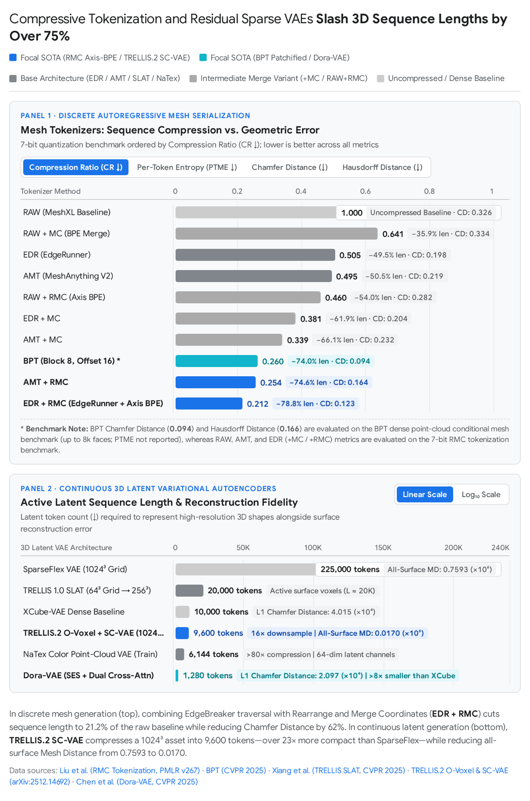
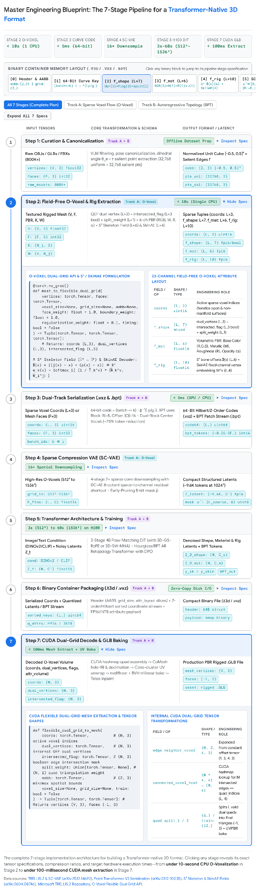

<!-- Extracted from the supplied DOCX; equations remain original images.
SHA256: ffa11ebbdc1510d4be92643724eabb7d8ed7091701048124057a2f2414973825 -->

Designing a Transformer-Native 3D Model Format: Architectural Ideology and Master Implementation Plan

A Transformer-native 3D model format fundamentally departs from the storage conventions of legacy Digital Content Creation (DCC) formats such as .obj, .fbx, and .glb, replacing unstructured vertex-index look-up tables and dense volumetric grids with canonically serialized, spatially localized, and information-dense token or latent structures1. Traditional 3D files are designed for random-access GPU rasterization rather than sequential or attention-based neural modeling: their vertex and face arrays are permutation-variant, exhibit severe long-range index dependencies across arbitrary memory addresses, and require costly, lossy pre-fitting into Signed Distance Fields (SDFs) that degrade open surfaces, non-manifold geometry, and internal structures2. To train a Transformer directly on 3D assets, the underlying format must mathematically align 3D Euclidean geometry, surface topology, Physically-Based Rendering (PBR) materials, and skeletal articulation with the inductive biases of self-attention—specifically 1D sequential locality, bounded context windows, and fixed-channel token embeddings3.

Across recent 3D foundation models (2024–2026), this ideology has crystallized into two primary architectural tracks that serve distinct downstream requirements5. Track 1 (Discrete Autoregressive Topological Token Formats)—exemplified by Blocked and Patchified Tokenization (BPT), EdgeRunner, Meshtron, and DeepMesh—encodes explicit polygonal meshes into compressed 1D discrete integer sequences via spatial block-offset indexing, local patch aggregation, or half-edge traversal opcodes, cutting sequence lengths by 49.5% to 78.8% so causal Transformers can synthesize artist-style wireframe topology and clean edge flow2. Track 2 (Field-Free Sparse Voxel & Vector-Set Structured Latents)—exemplified by Microsoft's TRELLIS.2 (O-Voxel / .vxz), Dora-VAE, NaTex, and AniGen (   Fields)—encodes arbitrary-topology geometry, 6-channel PBR materials, and skeletal skinning fields into active surface-intersecting sparse voxels or importance-sampled vector sets7. Compressed by 16× spatial-to-channel Sparse Compression VAEs (SC-VAE), this second track encodes a 1024³ fully textured asset into ~9,600 latent tokens (a ~23× reduction compared to competing sparse representations like SparseFlex at 225,000 tokens) and generates complete PBR assets in ~3 to ~60 seconds on a single NVIDIA H100 GPU7.

The report below is divided into two parts. Part 1 analyzes the theoretical and mathematical ideology behind Transformer-native 3D formats, comparing tokenization mechanics, compression ratios, spatial serialization curves, and multi-modal unification across leading paradigms. Part 2 delivers the complete plan.md engineering specification required to build a unified Transformer-native 3D model format (.t3d / .vxz) from scratch, detailing every pipeline stage from dataset curation and Quadratic Error Function (QEF) dual-grid extraction to 64-bit space-filling curve serialization, residual VAE compression, and CUDA-accelerated .glb post-processing4.

Part 1: The Ideology Behind Transformer-Native 3D Formats

1.1 Why Legacy 3D Formats Fail Sequence Models

Unlike 2D images—which naturally conform to regular, dense 2D pixel grids—or text—which exists as a 1D discrete sequence of subword tokens—3D assets suffer from acute representational fragmentation across polygon meshes, point clouds, neural radiance fields (NeRFs), 3D Gaussian Splats (3DGS), and volumetric grids23. Attempting to train a Transformer directly on standard graphics exchange formats (such as .obj or .glb) exposes four structural bottlenecks that impede model convergence and compute scaling:

Permutation Variance and Long-Range Index Dependencies: Standard mesh formats store a vertex coordinate table    followed by a triangle-vertex incidence table    referencing integer row indices in   25. Permuting the order of vertices in    and updating the pointers in    yields the exact same 3D surface in Euclidean space but produces a completely different token sequence8. Furthermore, adjacent triangles on a 3D surface may reference vertices stored thousands of lines apart in the file, forcing self-attention layers to learn arbitrary long-range pointer arithmetic rather than local geometric continuity2. Feeding raw .obj text directly into Large Language Models (as in LLaMA-Mesh) bypasses explicit mesh topology altogether27.

Quadratic Attention Explosion in Uncompressed Sequences: If a mesh is flattened into a raw sequence of quantized vertex coordinates ("triangle soup") sorted bottom-to-top, each triangle requires 9 tokens (3 vertices × 3 spatial axes   )10. Because every vertex in a manifold mesh is shared by an average of 6 triangles, vertex locations are repeated ~6 times across the sequence, expending ~60 bits per vertex or ~30 bits per triangle in excess storage5. At 9 tokens per face, a 32,000-face artist mesh expands to ~300,000 tokens10. Under standard causal self-attention, inference cost scales quadratically with mesh size, restricting early autoregressive generators (MeshGPT, MeshAnything, EdgeRunner) to ≤4,000 faces and coarse 128-level (7-bit) spatial quantization5.

The Iso-Surface Field Bottleneck (SDFs and Watertight Conversion): To avoid irregular mesh topology, many 3D generative pipelines (CLAY, Hunyuan3D 2.0, TRELLIS 1.0, Craftsman) first convert training meshes into continuous volumetric Signed Distance Fields (SDFs) or occupancy grids and extract surfaces via Marching Cubes or FlexiCubes1. However, real-world 3D assets frequently contain open surfaces (clothing, leaves, thin shells), non-manifold edges, and internal enclosed structures (car interiors, mechanical assemblies)7. Converting an arbitrary mesh to a watertight SDF via Unsigned Distance Field (UDF) level-set offsetting subtracts two voxel sizes—effectively halving the spatial resolution—and yields double-layered meshes where retaining only the largest connected component discards smaller internal geometry9. Moreover, iso-surface extraction tessellates surfaces along a regular grid, lacking the clean quad/triangle edge flows required by 3D technical artists for rigging and deformation13.

Cubic Memory Growth vs. Surface Sparsity: A dense 3D voxel grid scales cubically (  ) with spatial resolution   1. Yet 3D surfaces are sparse 2D manifolds embedded in 3D space: in a 64³ grid (   cells), an object's surface intersects an average of    active voxels (~7.6% occupancy)1. At 1024³ resolution (>1 billion voxels), dense volumetric attention becomes computationally intractable, necessitating formats that strictly allocate tokens to active surface neighborhoods (  )1.

1.2 The Four Foundational Pillars of Transformer-Native 3D Design

To transform an unstructured 3D asset into a representation that scales effectively with Transformer parameter counts and dataset size, modern 3D format architectures rely on four foundational design principles that bridge raw 3D geometry and sequence modeling.

Pillar 1: Deterministic Serialization & Locality Preservation

Because self-attention is intrinsically permutation-invariant, unordered 3D primitives must be mapped into a deterministic 1D sequence where sequence proximity correlates strongly with 3D Euclidean proximity3. In direct mesh generators (Meshtron, MeshXL) and skeletal tokenizers (UniRig), vertices, faces, or bone tail joints are normalized into a canonical unit cube and sorted lexicographically by their quantized    coordinates (bottom-to-top along the vertical axis)10. For manifold meshes where connectivity matters more than global height order, formats like EdgeRunner, TreeMeshGPT, and MeshRipple replace spatial sorting with half-edge Breadth-First Search (BFS) or depth-first adjacency stacks that spiral outward from a seed triangle along an active FIFO frontier queue   , ensuring every newly predicted triangle attaches directly to a known boundary edge and preventing flipped surface normals2.

In sparse point and voxel Transformers (Point Transformer V3, PointTransformerX, and the .vxz disk storage format noted in technical documentation for TRELLIS.2), 3D coordinates    are projected onto a discrete grid of scale    and mapped via the inverse of a bijective space-filling curve    into a single 64-bit integer serialization code3:

  

where the leading bits store the batch index    and the trailing    bits record the spatial traversal order20. While the Z-order (Morton) curve offers simple bitwise computation, the Hilbert curve preserves superior spatial locality20. By sorting points via these 64-bit integer mappings and cyclically shuffling four curve variants (Z-order, Transposed Z-order, Hilbert, and Transposed Hilbert) across successive Transformer layers, PTv3 eliminates costly   -Nearest Neighbor (KNN) searches (which previously consumed 28% of forward-pass runtime) and complex relative positional encodings (26% of forward-pass runtime), groups contiguous sequence slices into fixed-size patches for FlashAttention, expands receptive fields from 16 to 1,024 points, and reduces memory consumption by up to 10.2×3.

Pillar 2: Field-Free Surface Sparsity & Explicit Local Geometry

Rather than converting 3D meshes into watertight volumetric SDFs, next-generation formats (O-Voxel in TRELLIS.2 and SparseFlex in TripoSF) restrict representation strictly to surface-intersecting sparse voxels   4. In O-Voxel, each active cell stores a Flexible Dual Grid tuple    derived from direct intersections between grid edges and the input mesh surface (Hermite data: exact surface intersection points and normals) rather than signed-distance or occupancy fields4. Specifically, each active voxel holds one internal dual vertex    (solved via Quadratic Error Function minimization over intersecting triangle planes), three boolean edge-intersection flags    indicating which of the voxel's 3 primal edges are intersected by the surface, and quad-splitting weights that dictate how the dual quad formed by 4 neighboring active voxels divides into triangles19. Because no global inside/outside flood-fill is required, this representation natively models open cloth surfaces, non-manifold junctions, and internal enclosed structures while converting between textured meshes and O-Voxels in <10 seconds on a single CPU and extracting meshes in <100 milliseconds on CUDA without iterative optimization7.

Pillar 3: High-Ratio Sequence & Spatial-to-Channel Compression

Because Transformer compute scales with sequence length, a scalable 3D format must maximize the geometric information packed into every token. In discrete mesh formats, compression targets two sources of redundancy: coordinate representation and vertex sharing5. BPT splits Cartesian coordinates into coarse block indices (  ) and local intra-block offsets (  ), merging repeated block prefixes for neighboring vertices, and aggregates faces into star-shaped vertex patches that reduce center-vertex occurrences from an average of 6 down to 1 (~75% sequence length reduction)5. Complementarily, Rearrange & Merge Coordinates (RMC) regroups local triangle coordinates by axis    and applies SentencePiece Byte-Pair Encoding (BPE) to merge high-frequency cross-axis coordinate patterns into composite subword tokens, compressing EdgeRunner sequences by an additional 58% (achieving a Compression Ratio of 0.212 relative to raw sequences)15.

In continuous latent formats, SC-VAE in TRELLIS.2 applies 16× spatial downsampling across sparse voxel grids using non-parametric Sparse Residual Autoencoding shortcuts adapted from DC-AE4. At each 2× downsampling stage, the features of a parent voxel's 8 child octants (  ) are stacked into    and group-averaged into   , rearranging spatial hierarchy into channel dimensions so that a 1024³ volume compresses into ~9,600 tokens4. Conversely, Dora-VAE achieves compact 256-to-1,280-token vector sets (VecSet) by replacing uniform point sampling with Sharp Edge Sampling (SES), prioritizing vertices along high-dihedral-angle creases (  ) via Dual Cross-Attention18.

Pillar 4: Unified Multi-Modal Co-Alignment (Geometry, PBR, and Rigging)

In traditional pipelines, geometry, UV texture maps, and skeletal rigs live in separate coordinate spaces: 2D UV unwrapping introduces seams and topological dependency, multi-view texture projection suffers from occlusion inpainting artifacts, and post-hoc auto-rigging struggles when geometry and skeletons are generated sequentially without spatial coupling17. Transformer-native formats unify these modalities directly in 3D space. For appearance, O-Voxel binds a 6-channel PBR material vector    (RGB base color, metallic, roughness, and opacity) directly to each active geometry voxel   4. Similarly, NaTex encodes a continuous 3D surface color/PBR field as an ordered 9-channel point cloud    aligned with geometry latents via Rotary Position Embeddings (RoPE), deferring UV unwrapping and texture baking until final .glb export17. For animatable assets   , AniGen defines mutually consistent    Fields (Shape, Skeleton, Skin) over parallel sparse voxel branches (   and   ), using SkinAE to factorize variable-bone skinning matrices (  ) into fixed 4-channel vertex and joint embeddings (  )12. In the discrete domain, UniRig and SkinTokens serialize hierarchical bone trees and Finite Scalar Quantized (FSQ-CVAE) skinning weights into unified 1D token sequences38.

1.3 Taxonomy and Quantitative Comparison of Transformer-Native 3D Formats

To select or engineer a 3D format for Transformer training, architects must navigate trade-offs between polygon topology control (essential for low-poly game assets and artist editing) and scalability to ultra-high resolution, arbitrary topology, and PBR materials (essential for general 3D asset synthesis)5.

| Format / Framework | Representation Paradigm | Spatial / Coord Resolution | Tokenization / Compression Mechanism | Sequence Length / Compression Ratio | Supported Modalities | Primary Transformer Backbone & Speed |
| --- | --- | --- | --- | --- | --- | --- |
| MeshXL (RAW)15 | Discrete 1D Mesh Sequence | 128³ (7-bit) | Lexicographic    face sorting; 9 tokens/face | CR = 1.000 (9 tokens/face; PTME = 6.742) | Triangle mesh geometry | Causal AR Transformer (limited to <1K faces) |
| MeshGPT / MeshAnything49 | Discrete Learned Codebook | Graph-encoded faces | Graph Conv VQ-VAE with Residual Quantization (3 codebooks × 512 entries, dim 128) | Compressed latent face tokens; point condition = 4,096 pts | Manifold triangle meshes | Decoder-only AR Transformer + Noise-Resistant Decoder |
| MeshAnything V2 (AMT)2 | Discrete 1D Mesh Sequence | 128³ (7-bit) | Adjacent Mesh Tokenization (shared edge reuse; 199.5 sub-seqs/mesh) | CR = 0.462–0.495 (~4.5 tokens/face; PTME = 3.349) | Artist triangle meshes | Causal AR Transformer (tokenizes at 8.6 meshes/s) |
| EdgeRunner (EDR)2 | Discrete 1D Mesh + ArAE Latent | 128³ (7-bit) to 512³ (9-bit) | Adapted EdgeBreaker half-edge traversal opcodes (54.7 sub-seqs/mesh) | CR = 0.474–0.505 (4–5 tokens/face; PTME = 3.139) | Manifold triangle meshes (≤4K faces) | AR Auto-Encoder (ArAE) + Latent Diffusion (~100 tok/s; 45s/1K faces) |
| EDR + RMC15 | Discrete BPE-Merged Mesh | 128³ (7-bit) | EdgeRunner + axis-rearranged    SentencePiece BPE merging | CR = 0.212 (~1.9 tokens/face; PTME = 2.231) | Manifold triangle meshes | Causal AR Transformer (58% shorter than base EDR) |
| BPT (Blocked & Patchified)5 | Discrete Patch Sequence | 128³ (  ) | Block-offset coordinate indexing + high-degree vertex patch fan + dual-block vocab | ~75% length reduction (CR = 0.74 in BPT convention; >8K faces) | Artist triangle meshes | Causal AR Transformer (~2 min/mesh on 12GB VRAM fp16) |
| Meshtron10 | Periodic 1D Mesh Sequence | 1024³ (10-bit) | Uncompressed 9 tokens/face paired with 2-stage 3× sequence shortening | Uncompressed input (9× internal reduction; ≤64K faces) | Triangle & quad-dominant artist meshes | Hourglass AR Transformer + 8,192-face sliding window KV cache (2.5× tok/s) |
| DeepMesh14 | Discrete Hierarchical Blocks | 512³ (9-bit) | 3-level hierarchical block-offset indexing + neighbor merge | ~72% compression ratio (9K token context window; avg 8K faces) | DPO-aligned artist meshes | Causal AR Transformer + Direct Preference Optimization (DPO) |
| MeshRipple26 | Frontier-Guided Mesh Sequence | Quantized canonical box | Counterclockwise half-edge BFS + explicit FIFO frontier queue    + root offset    | Scales to 20,000 faces (1K-face windowed frontier attention) | Connected artist triangle meshes | Causal AR Transformer with Frontier Attention Masking |
| TRELLIS 1.0 (SLAT)1 | Sparse Voxel Structured Latent | 64³ grid (256³ decoded mesh) | Active surface voxels    + DINOv2 multiview features compressed via Sparse VAE |    active voxel tokens (  ) | Radiance Fields, 3DGS, FlexiCubes Meshes | 2-Stage Rectified Flow DiT (up to 2B params; 3D-SW-MHA; ~10s) |
| TRELLIS.2 (O-Voxel / .vxz)7 | Field-Free Sparse Voxel Latent | 512³, 1024³, 1536³ | Flexible Dual Grid (  ) + PBR (  ) + 16× SC-VAE residual downsampling | ~9,600 latent tokens at 1024³ (effective 64³ latent grid) | Arbitrary-topology Mesh + 6-ch PBR (RGB, M, R,   ) | 3-Stage Vanilla Flow DiT (4B params; H100: ~3s @512³, ~17s @1024³, ~60s @1536³) |
| Sparc3D (Sparcubes)9 | Sparse Deformable Marching Cubes | 1024³ | Narrow-band UDF + flood-fill sign + gradient-optimized deformable grid via Sparconv-VAE | Half the voxel count of dense baselines; <30 s remeshing | Guaranteed watertight print-ready meshes | Modality-consistent Sparse 3D CNN VAE + Latent Diffusion (trains 4× faster) |
| Dora-VAE / Hunyuan3D 2.x18 | Unordered Vector Set (VecSet) | 256³–512³ TSDF/Occupancy | Uniform (32K) + Sharp Edge Sampling (32K,   ) via Dual Cross-Attention |    tokens (default 1,280 tokens × dim 768) | Watertight SDF/TSDF meshes | Flow-Matching DiT (with MoE in Hunyuan3D 2.1; subsecond with FlashVDM) |
| NaTex17 | Ordered Point-Query VecSet | Continuous 3D surface field | 9-channel color/PBR point cloud (  ) compressed >80× with RoPE | 6,144 × 64 (train); scales to 12,288 × 64 or 24,576 × 64 (test) | UV-free 3D Albedo, Metallic, Roughness | 2B Multi-Control Color Flow DiT (supports 1-step to 10-step sampling) |
| UniRig / SkinTokens38 | Discrete Rig & Skin Sequence | Quantized unit cube    | Skeleton Tree tokens ([BOS], [Body], [Spring]) + Cross-Attn (UniRig) or FSQ-CVAE (SkinTokens) | Skeleton:    tokens (~30% reduction) +    SkinTokens | Hierarchical bone rig + physics stiffness + LBS weights | OPT Autoregressive Transformer + Geodesic Cross-Attn or RL refinement |
| AniGen (   Fields)12 | Co-Located Sparse Voxel Fields | Sparse voxel grid (  ) | Continuous Skeleton Field (  ) + SkinAE factorized embeddings (  ) | Dual-branch sparse voxel tokens coupled via linear adapters | Complete animatable tuple    | 2-Stage Parallel-Branch Flow DiT (SS-Flow + SLAT-Flow) |

  

Deep Dive: Why Discrete Mesh Tokenizers and Continuous Latent VAEs Diverge

As the benchmark data above illustrates, the evolution of 3D Transformer formats is governed by an information-theoretic trade-off between sequence length, per-token entropy, and topological validity. When Merge Coordinates (MC) applies standard Byte-Pair Encoding directly to serialized    coordinate streams, the Compression Ratio improves from 1.000 to 0.641 on RAW and from 0.505 to 0.381 on EdgeRunner (EDR), but Per-Token Mesh Entropy (PTME) paradoxically worsens (rising from 6.742 to 6.943 on RAW and from 3.139 to 3.244 on EDR), degrading Chamfer Distance from 0.198 to 0.20415. Because standard BPE merges only adjacent coordinate pairs    without cross-axis spatial awareness, the resulting tokens become harder for the Transformer to predict15. By first rearranging local 9-coordinate triangle blocks by axis    (RMC), BPE discovers 3-to-16-coordinate geometric patterns across vertices, slashing EDR PTME to 2.231 and improving Chamfer Distance by 37.9% (from 0.198 to 0.123)15.

Similarly, in Blocked and Patchified Tokenization (BPT), partitioning a 128³ coordinate space requires balancing block size    against intra-block offset size   5. Ablation experiments demonstrate that    (yielding    block tokens and    offset tokens) achieves the best Chamfer Distance (0.094) and Hausdorff Distance (0.166)5. Shrinking the block grid to    expands the offset vocabulary to    tokens—making next-token classification unaffordable and degrading Hausdorff Distance to 0.209—while enlarging blocks to    sacrifices local block-prefix merging and degrades Hausdorff Distance to 0.2565.

While BPT and EDR compress sequences to fit standard Transformer context windows, NVIDIA's Meshtron demonstrates an alternative ideology: retain the simple, uncompressed 9-tokens-per-face lexicographic format at high 1024³ quantization, and instead redesign the Transformer around the strict 9-step periodicity of triangle tokens10. Because predicting the first vertex of a new face has much higher perplexity than predicting the remaining coordinates of that face, Meshtron's Hourglass backbone uses two 3× shortening layers to process coordinate tokens at full length, vertex tokens at one-third length, and face tokens at one-ninth length, while evicting tokens older than 8,192 faces from the KV cache10. However, evaluations in BPT note that truncating sequences to fit smaller context windows with sliding-window inference can reduce robustness and produce more incomplete meshes, making compressive tokenization (BPT / DeepMesh) advantageous when training compute is constrained14.

Finally, in continuous sparse formats (PTv3, TRELLIS, SC-VAE), a major engineering bottleneck is their reliance on custom CUDA sparse convolution and scatter/gather libraries (spconv or custom Triton kernels such as FlexGMM noted in technical reviews of TRELLIS.2), which account for ~67% of parameters in PTv3 and restrict portability to non-NVIDIA hardware4. PointTransformerX (PTX) demonstrates that a serialized 3D format can run natively in standard PyTorch across NVIDIA GPUs, AMD ROCm GPUs, and CPUs by replacing prepositive sparse convolutions with 3D Gram-Schmidt Rotary Position Embeddings (3D-GS-RoPE)36. In 3D-GS-RoPE, each attention head learns 6 scalar parameters that are orthonormalized via Gram-Schmidt into a 3D coordinate rotation matrix   , projecting point coordinates    onto rotated axes    before applying axial RoPE rotations   36. This preserves Euclidean distances and cross-axis angles without materializing neighborhood matrices, retaining 98.7% of PTv3's ScanNet accuracy at 20.8% of the parameter count (9.6M parameters and 253 MB memory in BF16+FP8)36.

Part 2: plan.md — Master Engineering Plan to Build a Custom Transformer-Native 3D Format

The following specification is structured as a standalone, actionable plan.md blueprint. It details how to engineer a unified, production-grade Transformer-native 3D model format—designated .t3d (Transformer-3D Unified Container)—that combines Field-Free O-Voxel + PBR +    Articulation Latents (for fast 3D Flow-Matching DiT synthesis at up to 1536³ resolution) with an optional Blocked-and-Patchified Topological Stream (BPT) (for autoregressive artist-style retopology and edge-flow generation)5.

  

Step 1: Dataset Curation, Filtering, and Canonical Normalization

Training a 3D Transformer requires 300,000 to 500,000+ high-quality, diverse 3D assets curated from repositories such as Objaverse-XL, ABO, 3D-FUTURE, HSSD, Toys4k (as in TRELLIS-500K), and rigged repositories such as Anymate (230,000 rigged assets), Articulation-XL 2.0 (48,000+ models), and Rig-XL (14,000+ models)57. Because raw web-scraped 3D data contains broken scans, unaligned axes, and missing materials, execute the following deterministic preprocessing sequence:

VLM Aesthetic and Geometry Filtering: Render multi-view color, depth, and normal maps (at varying Fields of View for data augmentation) and use a Vision-Language Model (VLM) to filter out simple geometric primitives, ambient ground planes, and noisy photogrammetry scans (a pipeline that typically refines ~800K raw assets down to ~330K valid and ~120K–500K high-quality training assets)6. If training a PBR material generator, filter out assets lacking valid Physically-Based Rendering materials4.

Pose and Scale Canonicalization: Normalize all mesh vertex coordinates    and skeletal joint coordinates    into a canonical Axis-Aligned Bounding Box (aabb) centered at the origin, specifically    (or    for skeletal evaluation)16. Apply a pose-canonicalization network to align misposed objects to a consistent upright (   or   ) and front-facing orientation, and apply random 90° axial rotations (0°, 90°, 180°, 270°) during autoregressive training to improve orientation generalization14.

Salient Edge & Curvature Point Extraction (SES): For point-cloud conditioning encoders (Dora-VAE style), avoid uniform-only surface sampling18. Compute the dihedral angle    for every interior mesh edge    shared by adjacent faces   18:  Extract    uniformly sampled surface points    and    salient points    from the unique vertices    of salient edges    (using Farthest Point Sampling    if   , or linear edge interpolation if   )18. Store point positions alongside unit surface normals as   18.

Step 2: Mathematical Schema of the Native 3D Primitives (Dual-Track Design)

To support both instant general 3D asset synthesis with arbitrary topology/PBR and artist-grade low-poly wireframe generation, define the format schema around two interoperable tracks5.

Track A: Field-Free Omni-Voxel (O-Voxel) +    Articulation Tuple (For Flow-Matching DiTs)

Represent an asset at grid resolution    (  ) as a sparse collection of    active surface and skeleton voxels (  )4:

  

Geometric Dual-Vertex & Intersection Tuple (  ): Constructed via mesh_to_flexible_dual_grid in <10 seconds on a single CPU without rendering or SDF flood-filling21. Each active voxel stores dual_vertices (  , shape (L, 3)), representing the local offset of the dual vertex inside voxel    solved by minimizing a Quadratic Error Function (QEF) over the Hermite data (exact edge-surface intersection points and triangle normals) with default weights face_weight = 1.0, boundary_weight = 1.0, and regularization_weight = 0.119. Alongside the dual vertex, store intersected_flag (  , shape (L, 3) boolean) indicating whether the voxel's three primal edges intersect the mesh surface (which dictates dual quad creation across neighboring voxels), and split_weight (  , shape (L, 1)) controlling which diagonal divides each dual quad into two triangles (defaulting to minimum-angle splitting if None)19.

Volumetric PBR Material Tuple (  , shape (L, 6)): Sampled directly from the mesh's surface textures at each active voxel    as   , comprising RGB Base Color    (3 channels), Metallic ratio    (1 channel), Roughness    (1 channel), and Opacity/Alpha    (1 channel, enabling translucent glass and cutout foliage)4.

Articulation & Skinning Tuple (  , Optional    Extension): Following AniGen, embed rigging directly into the sparse voxel grid so the asset is immediately animatable12. Store skeleton_field (  ), which maps voxel center    to a concatenated 6D displacement vector pointing to its nearest skeletal joint    and that joint's parent    via   , alongside skin_embedding (  ), a fixed 4-channel vertex skinning latent produced by SkinAE (which encodes parent-relative bone vectors    into    via a Transformer encoder and computes    as the skin-weighted average of joint embeddings, decoupling channel count from the variable number of bones   )12.

Track B: Blocked and Patchified Topological Sequence (BPT) (For Autoregressive Mesh Retopology)

When explicit artist-style polygon edge flow is required (exceeding 8,000 faces in BPT or scaling via Hourglass attention in Meshtron), tokenize the mesh connectivity and quantized vertices into a compressed 1D discrete stream5:

Block-Offset Coordinate Decomposition: Quantize normalized Cartesian vertex coordinates    into    bins (or    in DeepMesh) and factorize each 3D coordinate into a coarse 3D Block Index    and a fine 3D Intra-Block Offset   5:  

High-Degree Patch Aggregation: Iteratively select the first unvisited face    in sorting order and pick its vertex    connected to the highest number of unvisited faces as the patch center5. Aggregate the fan of incident unvisited faces around    into a local patch sequence   , reducing the occurrences of    from an average of 6 down to 1, and merge identical block indices    among consecutive vertices residing within the same spatial block5.

Separator-Free Dual-Block Indexing: Maintain two distinct block-index vocabularies—   (512 tokens) used exclusively for patch centers   , and    (512 tokens) used for peripheral patch vertices   —while sharing    (4,096 tokens)5. Whenever a token from    appears in   , the detokenizer immediately begins a new fan patch without expending sequence length on separator tokens, yielding a compact vocabulary of    tokens and a ~75% sequence compression ratio5.

Step 3: 64-Bit Space-Filling Serialization and Binary Container Layout (.vxz / .t3d)

To store Track A (O-Voxel) and Track B (BPT) on disk and stream batches into GPU memory efficiently, serialize all sparse 3D coordinates using bijective space-filling curves (Point Transformer V3 and the .vxz sparse encoding reported in TRELLIS.2 technical analyses)16:

64-Bit Serialization Key Generation: For every active voxel coordinate    in batch item   , compute its 64-bit integer key using bitwise Morton (Z-order) interleaving or lookup-table Hilbert curve mapping   , allocating the trailing    bits (e.g., 33 bits for grids up to    per axis where   ) to the spatial curve position and the leading bits to the batch index   3.

Indirect Mapping Permutation (Zero Physical Reordering Overhead): During Transformer forward passes, avoid physically copying large feature tensors in GPU memory when changing serialization patterns; instead, compute integer index mappings for four curve variants—Z-Order (Z), Transposed Z-Order (TZ), Hilbert (H), and Transposed Hilbert (TH)—and cycle through them across attention layers (Shuffle Order)3.

Proposed On-Disk Binary Container Specification (.t3d / .vxz): Synthesizing the O-Voxel Python API tensor arguments (aabb, grid_size, voxel_size, coords, attr_volume, attr_layout)21 with Hilbert/Z-order curve storage16, structure the custom .t3d binary container with a fixed 128-byte header followed by aligned tensor payload blocks:

| Byte Offset / Block | Field Name | Data Type | Shape / Size | Engineering Specification & Role |
| --- | --- | --- | --- | --- |
| 0x00..0x07 | magic_version | char[4] + uint32 | 8 bytes | ASCII "T3DV" identifier + schema version (2) |
| 0x08..0x1F | aabb | float32[2][3] | 24 bytes | Canonical bounding box [[min_x, min_y, min_z], [max_x, max_y, max_z]]21 |
| 0x20..0x2B | grid_size | uint32[3] | 12 bytes | Voxel grid resolution   , e.g., (1024, 1024, 1024)21 |
| 0x2C..0x37 | voxel_size | float32[3] | 12 bytes | Physical voxel dimensions (aabb[1] - aabb[0]) / grid_size22 |
| 0x38..0x47 | counts | uint32[4] | 16 bytes | [L_active_voxels, L_latent_tokens, N_bpt_tokens, N_joints] |
| 0x48..0x7F | attr_layout | uint16[28] | 56 bytes | Slice offsets for dual_vertices, intersected_flag, split_weight, base_color, metallic, roughness, alpha, and rig22 |
| Block 1 | hilbert_coords | uint16[L, 3] |    bytes | Active voxel indices sorted strictly by 64-bit Hilbert/Z-order code16 |
| Block 2 | f_shape_mat_rig | float16[L, C] |    bytes | Raw O-Voxel attributes (optional if storing pre-compressed SC-VAE latents)4 |
| Block 3 | sc_vae_latents | float16[L_lat, D] |    bytes | Pre-encoded 16× downsampled shape & material latents (   at 1024³)7 |
| Block 4 | bpt_stream | uint16[N_bpt] |    bytes | Optional discrete BPT topological token sequence (Vocab <= 5120)5 |

Step 4: Building the Compression Engine (SC-VAE & SkinAE)

To compress high-resolution Track A O-Voxel grids (512³ to 1536³) into a compact token count (~9,600 tokens at 1024³) without losing thin surfaces or sharp creases, train two decoupled Sparse Compression VAEs (SC-VAE)—one for Shape (  ) and one for Material (  )—plus a lightweight SkinAE for articulation4:

ConvNeXt-Style Sparse Residual Blocks: Standard two-layer 3×3×3 submanifold sparse convolutions exhibit low effective computation and parameter efficiency on high-sparsity surface data4. Substitute the second sparse convolution layer in every residual block with a wide point-wise MLP (analogous to a Transformer FFN) that expands channel dimensions, paired with a single submanifold sparse convolution layer accelerated via optimized Triton kernels4.

Non-Parametric Sparse Residual Autoencoding Downsampler (16× Spatial Compression): Stack four 2× hierarchical downsampling stages (   total spatial reduction)4. To mitigate optimization degradation under 16× spatial compression (where removing the shortcut degrades 256³ Sketchfab Mesh Distance from 1.032 to 1.747 and lowers normal-map PSNR from 27.26 to 26.73), introduce a non-parametric space-to-channel residual shortcut within each 2× downsampling block4:  where typically    and missing child voxels contribute zero vectors due to sparsity4.

Symmetric Channel-to-Space Shortcut & Early-Pruning Upsampler: In the decoder, mirror the shortcut at each of the four 2× upsampling stages by unstacking coarse channels back to the 8 child octants and duplicating channel groups4:  Before each upsampling step, predict a binary occupancy mask    specifying the active child voxels of each parent node, skipping inactive nodes in subsequent layers to reduce memory and runtime4.

Reconstruction Supervision Losses: Supervise the Shape SC-VAE on O-Voxel dual-grid parameters (dual_vertices, intersected_flag, split_weight, and pruning masks   ) alongside rendered depth and normal map losses1. Supervise the Material SC-VAE using rendered multi-view color losses (  , SSIM, LPIPS) and PBR attribute reconstruction19. Train SkinAE to reconstruct ground-truth vertex-to-bone skinning weights    using KL-divergence loss and confidence-weighted joint regression loss, then freeze SkinAE before generative flow training12.

Step 5: Transformer Backbone Architecture and Multi-Stage Training Protocol

Train the generative models directly on the compressed .t3d / .vxz representations using a Decoupled 3-Stage Flow-Matching Diffusion Transformer (DiT) (scaled up to 4 billion parameters as in TRELLIS.2) for Track A and an Hourglass/BPT Autoregressive Transformer for Track B5:

Track A Stage 1 — Sparse Occupancy Flow Transformer: Predict the coarse 3D binary occupancy layout of active latent voxels (e.g., a 64³ latent grid for a 1024³ O-Voxel asset after 16× downsampling) conditioned on DINOv2/DINOv3 image tokens or CLIP text tokens via cross-attention1. When generating animatable assets (AniGen mode), process a parallel Shape Branch (predicting surface-crossing voxels   ) and Skeleton Branch (predicting bone-containing voxels   ), exchanging information at every Transformer block via lightweight linear adapters so the skeleton grows strictly within the mesh bounds12.

Track A Stage 2 — Geometry & Rig Latent Flow Transformer: Given the active sparse coordinates    from Stage 1 (   at 1024³), denoise Gaussian noise    into clean SC-VAE shape latents    (and    rig latents) along a linear Rectified Flow trajectory    (  )12:  Pack local    neighborhoods and apply either 3D Shifted-Window Multi-Head Attention (3D-SW-MHA) or pure-PyTorch 3D Gram-Schmidt RoPE (3D-GS-RoPE) over Hilbert-serialized token patches, injecting timestep    via Adaptive Layer Normalization (adaLN-Zero)1. (Implementation Caveat: If using an unordered point-query VecSet bottleneck like Dora-VAE instead of SC-VAE, avoid adding static positional encodings to the latent space, as unordered queries cause positional encodings to harm convergence; instead, use progressive token-length warmup from    tokens in bf16-mixed precision43).

Track A Stage 3 — Shape-Conditioned Material Flow Transformer: Condition the material flow DiT on both the input prompt/image and the generated clean shape latents    from Stage 2 to predict PBR material latents   19. Decoupling geometry and material generation prevents baked-in lighting artifacts and supports fast shape-conditioned texture synthesis (~1 second for materials at 512³, ~7 seconds at 1024³, and ~25 seconds at 1536³ on an H100 GPU)7.

Track B — Autoregressive Topological Transformer + DPO Post-Training: Condition a causal Transformer (or a 3-stage Hourglass Transformer with two 3× shortening layers and an 8,192-face sliding window KV cache) on a point cloud (e.g., 4,096 points sampled from the Track A mesh) to autoregressively emit BPT patch tokens    via next-token cross-entropy loss5. Post-train the autoregressive generator with Direct Preference Optimization (DeepMesh DPO) over preferred and dispreferred mesh pairs    to align outputs with human topology preferences and reduce incomplete or broken surfaces14:  

Reference Training Hyperparameters: Train with the AdamW optimizer (lr = 1e-4 with cosine decay to 1e-5, weight decay 0.1), bf16-mixed precision, classifier-free guidance (CFG) drop rate 0.1, and batch size 256 across 32 to 64 A100/H100 GPUs for 400K steps; at inference, use 50 sampling steps with CFG = 3.0 for flow matching or probabilistic sampling with temperature = 0.5 for autoregressive mesh generation6.

Step 6: Fast CUDA Decoding and Production .GLB Post-Processing Pipeline

Once the Transformer generates the .t3d / .vxz representation and SC-VAE decodes the sparse tensors (coords, dual_vertices, intersected_flag, split_weight, attr_volume), execute the two-phase GPU extraction pipeline (flexible_dual_grid_to_mesh followed by to_glb) to produce a production-ready .glb asset21:

Instant Dual-Grid Mesh Extraction (<100 ms on CUDA): Initialize a GPU hash table (uint32 keys if   , else uint64) mapping active 3D voxel coordinates coords (L, 3) to their row indices21. For every active voxel and each of its 3 primal edges where intersected_flag is True (   intersected edges), query the 4 neighboring voxels sharing that edge (edge_neighbor_voxel shape (L, 3, 4, 3)    connected_voxel_indices (M, 4)), retain valid quads where all 4 neighboring dual vertices are present (quad_indices (Q, 4)), and split each quad into 2 triangles using split_weight to output vertices (V, 3) and faces (F, 3)19.

Topological Cleaning, Hole Filling, and Decimation (CuMesh): Move vertices and faces to CUDA inside cumesh.CuMesh, run initial hole filling mesh.fill_holes(max_hole_perimeter=3e-2) to seal minor topological discontinuities, and construct a CUDA Bounding Volume Hierarchy bvh = cumesh.cuBVH(vertices, faces) over the high-resolution surface7. For standard fast export (remesh == False), simplify to    target via mesh.simplify(decimation_target * 3), execute remove_duplicate_faces(), repair_non_manifold_edges(), remove_small_connected_components(1e-5), and fill_holes(3e-2), then decimate to decimation_target (up to 1,000,000 faces), repeat the cleanup pass, and call mesh.unify_face_orientations()16. For strict watertight export (remesh == True), run cumesh.remeshing.remesh_narrow_band_dc (band = 1, project_back = 0.9 snapping vertices onto bvh) before simplifying to decimation_target22.

Cone-Clustered UV Unwrapping & BVH-Projected Trilinear Texture Baking: Unwrap UVs via mesh.uv_unwrap() using cone-based clustering (threshold_cone_half_angle_rad = np.radians(90.0), global_iterations = 1, smooth_strength = 1) to obtain out_vertices, out_faces, out_uvs (N_out, 2), and out_vmaps22. Rasterize out_uvs in clip space into a 2D buffer rast of shape (1, texture_size, texture_size, 4) (e.g., texture_size = 2048 or 4096) in chunks of 100,000 faces using nvdiffrast (dr.RasterizeCudaContext()), interpolate 3D world positions pos across valid pixels (mask = rast[0, ..., 3] > 0), and project valid_pos onto the exact closest triangle of the original high-res mesh via bvh.unsigned_distance(valid_pos, return_uvw=True)16. Sample attr_volume (L, 6) at those exact 3D points using trilinear sparse interpolation (grid_sample_3d from flex_gemm.ops.grid_sample), slice base_color, metallic, roughness, and alpha into uint8 maps, and run Telea's inpainting (cv2.inpaint(..., cv2.INPAINT_TELEA)) across mask_inv to eliminate UV seam artifacts22.

Coordinate Convention Alignment & .GLB Packaging: Pack roughness into the Green channel and metallic into the Blue channel of metallicRoughnessTexture inside trimesh.visual.material.PBRMaterial22. If    rigging fields were generated, cluster the predicted joint displacement field    into discrete joints, decode per-vertex skinning weights via the frozen SkinAE MLP decoder, and attach the rig12. Finally, convert vertex positions and normals to glTF standard Y-up coordinates (  ,   ), flip vertical UVs (  ), and export the binary .glb file22.

Step 7: Validation Benchmarks and Quality Assurance Protocol

Before deploying the custom format and trained Transformer to production, validate reconstruction and generation fidelity across four standardized evaluation suites:

Geometric & Sharp-Feature Reconstruction (Dora-Bench & Sketchfab-90): Stratify test shapes into 4 complexity tiers based on salient edge count   —Level 1 (  ), Level 2 (  ), Level 3 (  ), and Level 4 (  )68. Target an all-surface bidirectional Mesh Distance (  ) near 0.0170 at 1024³ resolution (as achieved by TRELLIS.2 on the 90-asset Sketchfab Featured benchmark) and a Sharp Normal Error (  ) < 1.60 on Level 4 shapes (matching Dora-VAE's 1.579)19.

Sequence Locality & Entropy Auditing (Track B): Measure Compression Ratio (CR), Per-Token Mesh Entropy (PTME), and Average Vertex Distance (  ) across context offsets   11. Verify that the tokenizer achieves sequence reduction of ~72% to 78.8% (CR    in RMC convention),   , and sub-sequence fragmentation < 60 sub-sequences per mesh (matching EdgeRunner's 54.7 vs. AMT's 199.5)2.

PBR Material & Multi-View Relighting Fidelity: Render reconstructed and generated assets under diverse HDRI lighting conditions and evaluate Peak Signal-to-Noise Ratio (targeting normal-map    and albedo   ), SSIM, and LPIPS against ground-truth renders17.

Articulation & Deformation Robustness (UniRig / Anymate Protocol): Evaluate predicted skeletons using normalized Joint-to-Joint (J2J), Joint-to-Bone (J2B), and Bone-to-Bone (B2B) Chamfer distances inside   , alongside KL/   skinning weight accuracy and multi-pose animation deformation smoothness rewards (Volumetric Joint Coverage, Bone-Mesh Containment, Skinning Coverage/Sparsity, and Deformation Smoothness) to verify that bones stay inside the mesh and limbs deform cleanly under motion47.

Works cited

Structured 3D Latents for Scalable and Versatile 3D Generation, https://openaccess.thecvf.com/content/CVPR2025/papers/Xiang_Structured_3D_Latents_for_Scalable_and_Versatile_3D_Generation_CVPR_2025_paper.pdf

Auto-regressive Auto-encoder for Artistic Mesh Generation - arXiv, https://arxiv.org/html/2409.18114v1

Point Transformer V3: Simpler, Faster, Stronger - Emergent Mind, https://www.emergentmind.com/papers/2312.10035

Native and Compact Structured Latents for 3D Generation - arXiv, https://arxiv.org/html/2512.14692v1

Scaling Mesh Generation via Compressive Tokenization - arXiv, https://arxiv.org/html/2411.07025v1

Structured 3D Latents for Scalable and Versatile 3D Generation - arXiv, https://arxiv.org/html/2412.01506v1

microsoft/TRELLIS.2-4B - Hugging Face, https://huggingface.co/microsoft/TRELLIS.2-4B

Scaling Mesh Generation via Compressive Tokenization, https://www.researchgate.net/publication/394629502_Scaling_Mesh_Generation_via_Compressive_Tokenization

NeurIPS Poster Sparc3D: Sparse Representation and Construction, https://neurips.cc/virtual/2025/poster/115101

https://developer.nvidia.com/blog/high-fidelity-3d-mesh-generation-at-scale-with-meshtron/

(PDF) Scaling Mesh Generation via Compressive Tokenization, https://www.researchgate.net/publication/385720992_Scaling_Mesh_Generation_via_Compressive_Tokenization

AniGen: Unified S^3 Fields for Animatable 3D Asset Generation - arXiv, https://arxiv.org/html/2604.08746v1

https://github.com/wanshuiyin/ARIS-in-AI-Offer/blob/main/docs/tutorials/3d_generation_tutorial.md

Auto-Regressive Artist-mesh Creation with Reinforcement Learning, https://www.openaccess.thecvf.com/content/ICCV2025/papers/Zhao_DeepMesh_Auto-Regressive_Artist-mesh_Creation_with_Reinforcement_Learning_ICCV_2025_paper.pdf

https://raw.githubusercontent.com/mlresearch/v267/main/assets/liu25bz/liu25bz.pdf

TRELLIS.2-4B Explained: Single-Image 3D with O-Voxel, PBR GLB, https://mer.vin/2026/05/trellis-2-4b-explained-single-image-3d-with-o-voxel-pbr-glb-and-3-second-inference/

NaTex: Seamless Texture Generation as Latent Color Diffusion, https://openaccess.thecvf.com/content/CVPR2026/papers/Lai_NaTex_Seamless_Texture_Generation_as_Latent_Color_Diffusion_CVPR_2026_paper.pdf

Dora: Sampling and Benchmarking for 3D Shape Variational Auto, https://arxiv.org/html/2412.17808v1

Native and Compact Structured Latents for 3D Generation - alphaXiv, https://www.alphaxiv.org/abs/2512.14692

arXiv:2312.10035v2 [cs.CV] 25 Mar 2024, https://arxiv.org/pdf/2312.10035

TRELLIS.2/o-voxel/o_voxel/convert/flexible_dual_grid.py at ... - GitHub, https://github.com/microsoft/TRELLIS.2/blob/main/o-voxel/o_voxel/convert/flexible_dual_grid.py

TRELLIS.2/o-voxel/o_voxel/postprocess.py at main ... - GitHub, https://github.com/microsoft/TRELLIS.2/blob/main/o-voxel/o_voxel/postprocess.py

Structured 3D Latents - VALSE, https://valser.org/webinar/slide/slides/20250312/Trellis-2025-03-11-Jiaolong%20Yang.pdf

Meshtron: High-Fidelity, Artist-Like 3D Mesh Generation at Scale, https://www.researchgate.net/publication/387054028_Meshtron_High-Fidelity_Artist-Like_3D_Mesh_Generation_at_Scale

(PDF) Edgebreaker: connectivity compression for triangle meshes, https://www.researchgate.net/publication/3410854_Edgebreaker_Connectivity_Compression_for_Triangle_Meshes

MeshRipple: Structured Autoregressive Generation of Artist-Meshes, https://openaccess.thecvf.com/content/CVPR2026/papers/Lin_MeshRipple_Structured_Autoregressive_Generation_of_Artist-Meshes_CVPR_2026_paper.pdf

NVIDIA meshtron: high fidelity 3D mesh generation at scale - Reddit, https://www.reddit.com/r/augmentedreality/comments/1hhxya3/nvidia_meshtron_high_fidelity_3d_mesh_generation/

PART-X-MLLM: PART-AWARE 3D MULTIMODAL - ICLR Proceedings, https://proceedings.iclr.cc/paper_files/paper/2026/file/f38cb4cf9a5eaa92b3cfa481832719c6-Paper-Conference.pdf

MeshFlow: Efficient Artistic Mesh Generation via MeshVAE and Flow, https://arxiv.org/html/2606.04621v2

Scaling Mesh Generation via Compressive Tokenization - scime atlas, https://atlas.scime.ai/paper/27579/scaling-mesh-generation-via-compressive-tokenization

Discrete Diffusion Model for High-Fidelity 3D Meshes Generation, https://arxiv.org/pdf/2510.21264

Hunyuan3D Studio: End-to-End AI Pipeline for Game-Ready 3D, https://arxiv.org/html/2509.12815v1

GitHub - VAST-AI-Research/TripoSF: SparseFlex: High-Resolution, https://github.com/VAST-AI-Research/TripoSF

SPARC3D: Revolutionary Single-Image 3D Reconstruction, https://www.creativeshrimp.com/sparc3d-ai-mesh-from-image.html

arXiv:2406.17442v3 [cs.CV] 13 Jan 2025, https://arxiv.org/pdf/2406.17442

PointTransformerX: Portable and Efficient 3D Point Cloud ... - arXiv, https://arxiv.org/pdf/2604.24169

Meshtron: High-Fidelity, Artist-Like 3D Mesh Generation at Scale, https://arxiv.org/html/2412.09548v1

One Model to Rig Them All: Diverse Skeleton Rigging with UniRig, https://arxiv.org/html/2504.12451v1

PointTransformerX: Portable and Efficient 3D Point Cloud ... - arXiv, https://arxiv.org/html/2604.24169v1

: Extending Native 3D Generators to the Part Level - arXiv, https://arxiv.org/html/2609.15659v1

Barycentric Dominance Field for 3D Native Mesh Generation - arXiv, https://arxiv.org/html/2606.31777v1

microsoft/TRELLIS.2: Native and Compact Structured Latents for 3D, https://github.com/microsoft/trellis.2

GitHub - Seed3D/Dora: [CVPR 2025] Official repository for "Dora, https://github.com/Seed3D/Dora

Dora: Sampling and Benchmarking for 3D Shape Variational Auto, https://aruichen.github.io/Dora/

AniGen: Unified S^3 Fields for Animatable 3D Asset Generation - arXiv, https://arxiv.org/html/2604.08746v2

https://datameister.ai/blog/trellis-2-controlled-3d-generation/

SkinTokens: A Learned Compact Representation for Unified ... - arXiv, https://arxiv.org/html/2602.04805v1

VertexRegen: Mesh Generation with Continuous Level of ... - GitHub, https://github.com/zhaoyang97/Paper-Notes-en/blob/main/docs/ICCV2025/3d_vision/vertexregen_mesh_generation_with_continuous_level_of_detail.md

README.md - VQ-VAE for 3D Meshes (MeshGPT-style) - GitHub, https://github.com/vixrino/vq-vae-meshGPT/blob/main/README.md

Idea Sharing | MeshGPT Significantly Improves the Quality of 3D, https://www.mindspore.cn/technology-blogs/en/3019

https://proceedings.iclr.cc/paper_files/paper/2025/file/7fc69f53a6ca2664ef23a9597903ca6f-Paper-Conference.pdf

CVPR Poster Scaling Mesh Generation via Compressive Tokenization, https://cvpr.thecvf.com/virtual/2025/poster/33503

GitHub - Tencent-Hunyuan/bpt: Official code for paper: Scaling Mesh, https://github.com/Tencent-Hunyuan/bpt

Auto-Regressive Artist-mesh Creation with Reinforcement Learning, https://arxiv.org/html/2503.15265v1

Sparc3D — Revolutionary 3D Generation | High-Resolution, http://sparc3d.org/

One Model to Rig Them All: Diverse Skeleton Rigging with UniRig, https://www.alphaxiv.org/abs/2504.12451

microsoft/TRELLIS: Official repo for paper "Structured 3D Latents for, https://github.com/microsoft/TRELLIS

One Model to Rig Them All: Diverse Skeleton Rigging with UniRig, https://arxiv.org/pdf/2504.12451

UltraShape 1.0: High-Fidelity 3D Shape Generation via Scalable, https://arxiv.org/html/2512.21185v1

Anymate: A Dataset and Baselines for Learning 3D Object Rigging, https://anymate3d.github.io/

Rig and Animate Your 3D Models, https://neurips.cc/media/neurips-2025/Slides/117585.pdf

Development of a User-Driven 3D Model Generation Support ... - MDPI, https://www.mdpi.com/2673-4591/159/1/22

Scaling Mesh Generation via Compressive Tokenization, https://whaohan.github.io/bpt/

UltraShape 1.0: High-Fidelity 3D Shape Generation via Scalable, https://arxiv.org/html/2512.21185

Point Transformer V3: Simpler, Faster, Stronger - arXiv, https://arxiv.org/html/2312.10035v2

Position Forcing: Self-Conditioning 3D Generation - arXiv, https://arxiv.org/html/2610.10342v1

Sampling and Benchmarking for 3D Shape Variational Auto-Encoders, https://www.researchgate.net/publication/394612833_Dora_Sampling_and_Benchmarking_for_3D_Shape_Variational_Auto-Encoders

Sampling and Benchmarking for 3D Shape Variational Auto-Encoders, https://www.themoonlight.io/en/review/dora-sampling-and-benchmarking-for-3d-shape-variational-auto-encoders

Dora: Sampling and Benchmarking for 3D Shape Variational Auto, https://atlas.scime.ai/paper/25996/dora-sampling-and-benchmarking-for-3d-shape-variational-auto-encoders

Interactive Authoring of 3D Gaussians from 2D Edits via Test-Time, https://arxiv.org/html/2512.05354v2

RigMo: Unifying Rig and Motion Learning for Generative Animation, https://openaccess.thecvf.com/content/CVPR2026/papers/Zhang_RigMo_Unifying_Rig_and_Motion_Learning_for_Generative_Animation_CVPR_2026_paper.pdf

